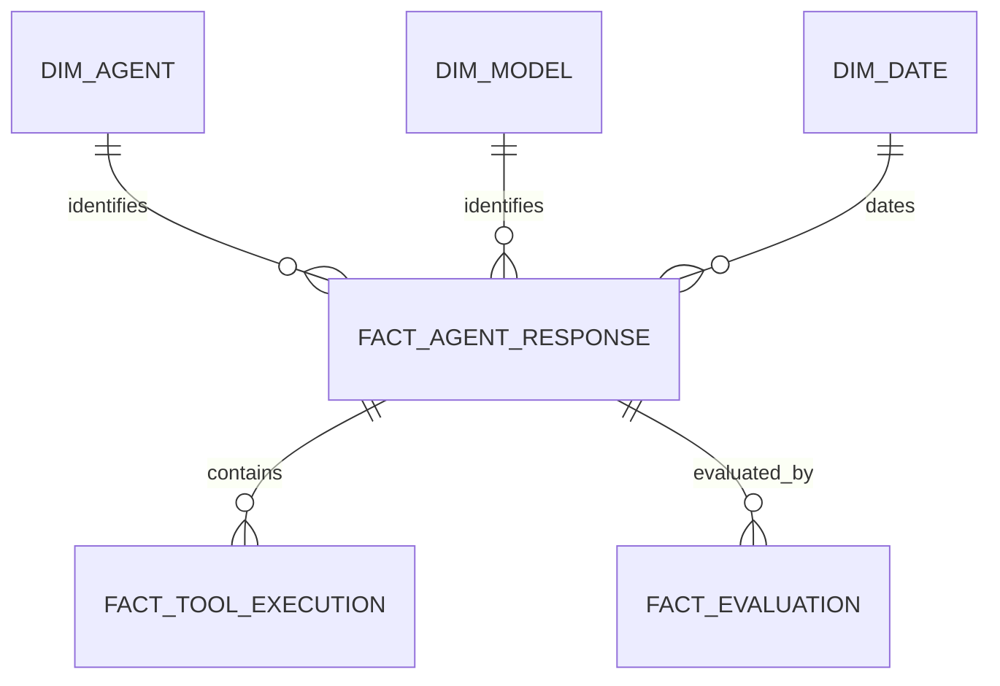

# Database design (initial)

PostgreSQL dimensional model. Each fact table has a clearly defined grain.

| Table | Grain and keys |
|---|---|
| dim_agent | One agent; agent_id PK, name, application, environment |
| dim_model | One provider/model/version identity; model_key PK, unique natural identity |
| dim_date | One UTC calendar day; date_id PK |
| fact_agent_response | One request attempt; event_id PK, agent_id/model_key/date_id FKs, session, prompt version, timestamp, tokens, latency, status, source |
| fact_tool_execution | One tool attempt; event_id PK, response_event_id FK, name, duration, status |
| fact_evaluation | One evaluation event; event_id PK, response_event_id FK, evaluator/version, benchmark run, score, evaluated_at |
| fact_pipeline_run | One pipeline execution; run_id PK, counts, timing and status |
| quarantined_events | One rejected record occurrence; ID, raw reference, reason and timestamp |
| model_pricing | Versioned provider rates and effective dates; optional |
| benchmark_runs | One benchmark execution; run ID, dataset/version and configuration |

Gold views aggregate per date, agent, model, source and prompt version. Compute success rate from request outcomes; accuracy only from comparable evaluated benchmark cases; avoid multiplying token counts when joining multiple evaluations. Use unique event IDs and transactional loads. Exact DDL, indexes and migrations are pending.
