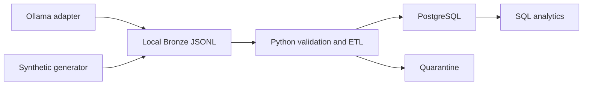
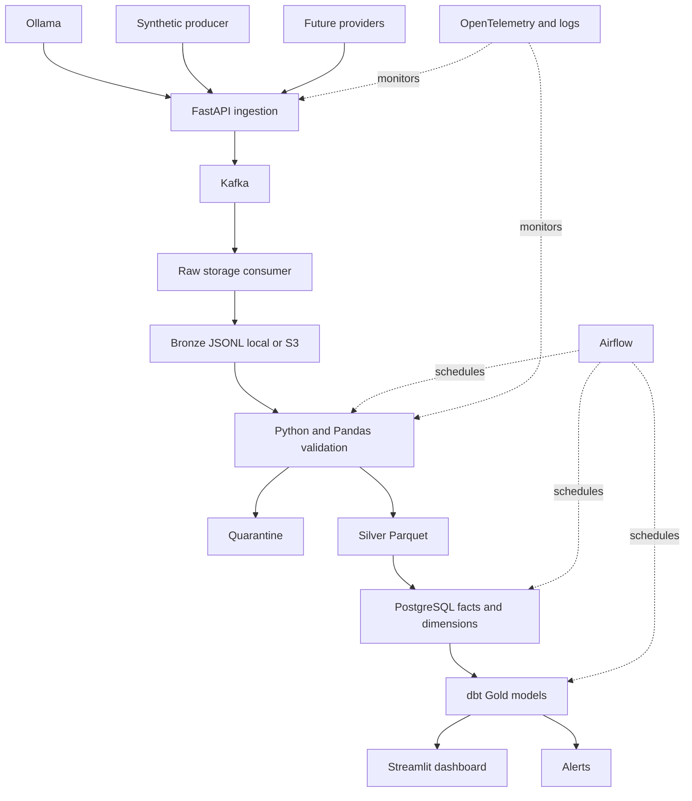

# High-level design

## MVP

## Target

Push ingestion and historical imports share a versioned contract. Ingestion acknowledges only after durable storage or broker acknowledgement. Consumer offsets are committed after durable writes. Batch and streaming paths share validation and idempotent load logic. Raw metadata excludes private content. AWS S3/RDS/ECS/CloudWatch are optional later integrations; no paid dependencies for MVP.
